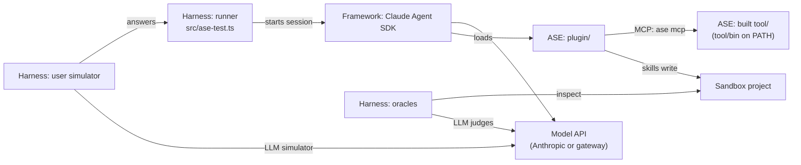
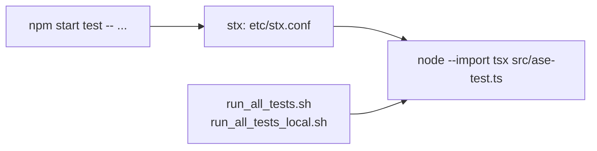
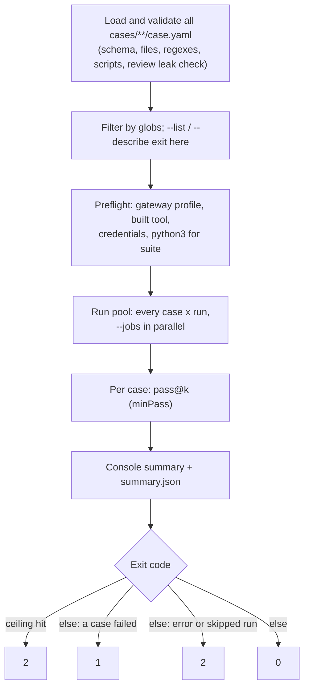
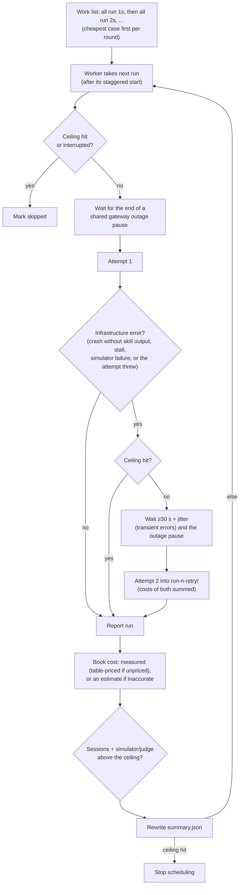
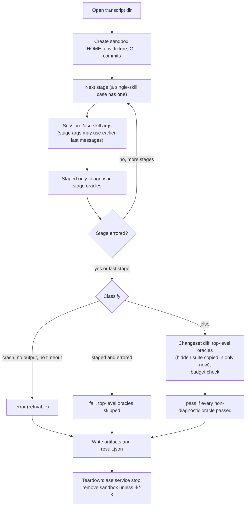
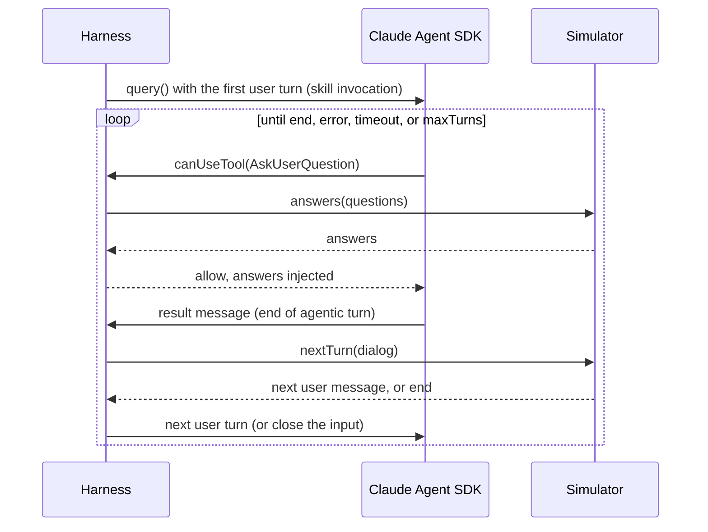
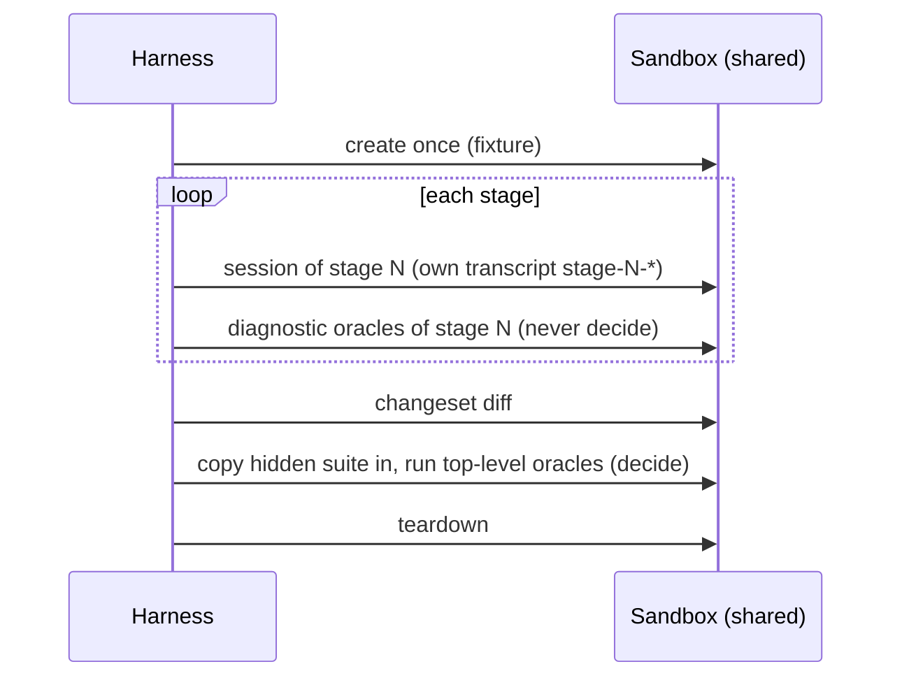
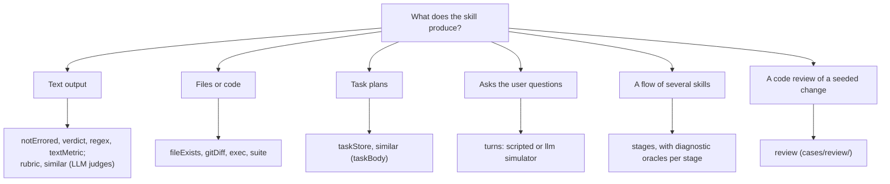

ASE Skill Test Harness: Architecture
====================================

How the harness is built and how it executes a test, as diagrams, plus
which parts are framework and where the harness touches **ASE**. For
the case format and all defaults, see `TESTS.md`; for adding a test,
see `README.md`.

## 1. Overall Architecture

-   **Harness** (`src/`): loads the cases, schedules the runs, drives
    the sessions, simulates the user of interactive skills, and
    evaluates the outcome.
-   **Framework**: the *Claude Agent SDK* ships its own Claude Code
    runtime and does the agent work against the Anthropic API or an
    Anthropic-compatible gateway.
-   **ASE under test**: the session loads `plugin/` straight from the
    surrounding ASE working copy, and the plugin starts the *built*
    `tool/` (the `ase` MCP server and service).

> **Notice:** after changing `tool/src/`, rebuild the tool
> (`cd ../tool && npm start build`), else the tests run stale code.

## 2. Launch Chain

*stx* is the task runner (`npm start <target>` runs a target of
`etc/stx.conf`); it eats bare words and detached option values, so use
`--cases=<glob>` (see `TESTS.md`). `--import tsx` transpiles the
TypeScript on import, so the harness has no build step (`tsc` only
type-checks it in `npm start lint`).

## 3. One Invocation

### Scheduling, Retry, and Ceiling

A timeout is never retried, as it is the most expensive failure mode.
A failed evaluation (e.g. a judge timeout) retries only the oracles and
ends as an infrastructure `error`. A gateway error (e.g. `Couldn't load
settings from Cloud gateway`, HTTP 5xx) pauses all workers of all
runners through a shared outage file. A SIGINT/SIGTERM aborts all live
sessions, tears down their sandboxes, and writes the final summary.

## 4. One Run (Attempt)

### Multi-Turn Session

A case with `turns` runs a multi-turn session with streaming input; a
case without runs single-shot (`AskUserQuestion` disallowed).

### Staged Case

## 5. Choosing Oracles

Prefer the mechanical oracles: they are free and deterministic. Use the
LLM judges (`rubric`, `similar`) only where the quality of free text
matters.

## 6. Framework vs. Harness

| Layer                                               | Role                                                                                         | Owner                  |
|-----------------------------------------------------|----------------------------------------------------------------------------------------------|------------------------|
| Claude Agent SDK (`@anthropic-ai/claude-agent-sdk`) | runs the sessions (own Claude Code runtime, plugins, hooks, MCP, permissions, cost), and the judge and simulator completions without an API key (OAuth) | Anthropic (dependency) |
| Anthropic SDK (`@anthropic-ai/sdk`)                 | direct judge and simulator completions with an API key                                       | Anthropic (dependency) |
| `src/*.ts`                                          | discovery, sandboxes, session driver, simulators, oracles, judges, reporting                 | Harness                |
| `src/review/`                                       | scorer and standalone tools of the review benchmark (plain Node.js `.mjs`)                   | Harness                |
| `cases/`                                            | inputs, fixtures, and expected outputs                                                       | Test data              |

## 7. Touchpoints with ASE

The harness never imports ASE code; it drives ASE as a black box.

| Touchpoint                                    | How                                                                                     | Consequence                                                                 |
|-----------------------------------------------|-----------------------------------------------------------------------------------------|-----------------------------------------------------------------------------|
| location                                      | the harness resolves ASE as its parent directory                                        | it must be checked out *directly* inside ASE                                |
| `plugin/`                                     | loaded from the working copy as a local plugin                                          | skill, sub-agent, meta file, and hook changes are tested without `ase setup` |
| `tool/bin/ase`, `tool/dst/`                   | `tool/bin` on the sandbox `PATH`; the plugin starts `ase mcp`, which spawns `ase service` | the *built* tool is tested: rebuild after changing `tool/src/`             |
| `ase service stop`                            | called on teardown                                                                      | stops the background service of the sandbox                                 |
| `.ase/config.yaml`                            | written from `fixture.config`                                                           | coupled to the ASE configuration keys                                       |
| `.ase/task/TASK-*.md`, `PROJECT.yaml`         | fixtures in the task file format; `taskStore` and `taskBody` parse it back              | coupled to the *format* of `tool/src/ase-task-format.ts`, not to its code   |
| skill output conventions (`▶ ERROR:`, verdict words, ...) | matched by the oracles and the infrastructure error classification          | coupled to `plugin/meta/ase-skill.md` and the `SKILL.md` templates          |
| `ase-repo-review` output                      | the verdict and findings table, parsed by the `review` oracle                           | coupled to the output format of that skill                                  |
| `skillErrored`, `verdictOf`, `changesetDiff`, `skillPrompt`, `brief` | copied into `src/ase-test-{oracle,session,transcript}.ts`, with comments naming the originals in `tool/src/ase-agent-runtime-*.ts` | copies drift silently when the originals change |

> **Notice:** the task file format, the skill output wording, and the
> copied helpers are invisible to the build: an ASE change there breaks
> tests without any compile error. Check them first when tests fail
> after an ASE change which "should not" affect them.
