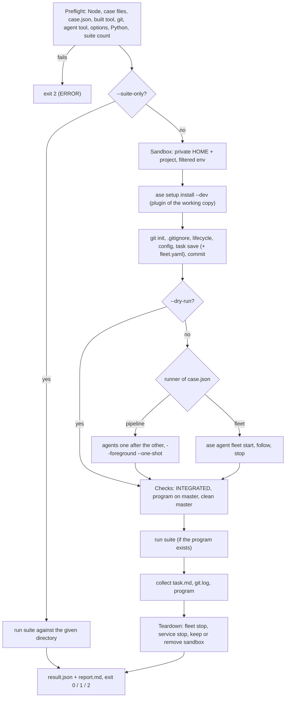
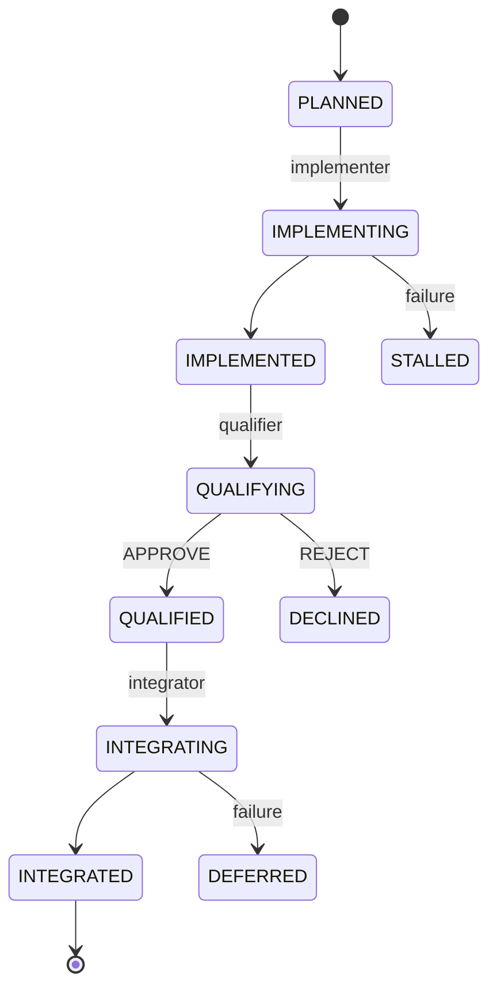
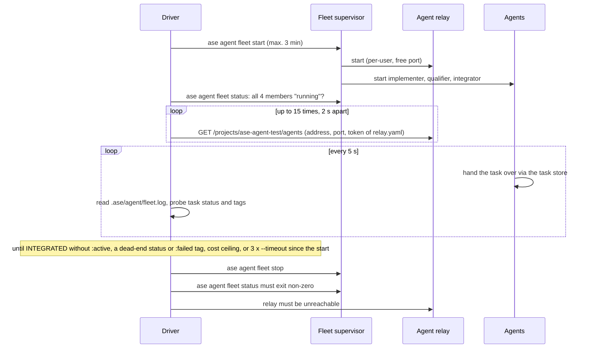

ASE Agent End-to-End Test
=========================

## About

This directory holds a standalone end-to-end system test of `ase agent`.
Unlike the skill harness in `src/`, it does not drive skills through the
Agent SDK. Instead, it runs the real built-in agents `implementer`,
`qualifier` (mode `qualify`), and `integrator` (mode `squash`) as separate
processes, the same way a user would, and drives one task fixture through
the `enterprise` lifecycle from `PLANNED` to `INTEGRATED`. A black-box
Python test suite then checks the program the agents left on `master`.

The driver `ase-agent-test.mts` has no dependencies: Node >= 22.22 runs it
directly through type stripping. It spawns processes without a shell,
runs `ase` as `node <ASE>/tool/bin/ase` (the `tool/` of the surrounding
ASE working copy, i.e., `../tool`), and finds Python as `python3`,
`python`, or `py -3`, so it works on Linux, macOS, and Windows alike.

> **Notice:** A real run spends real AI tokens (about $1.70 and 4 minutes per
> case with `claude-sonnet-5-5`).

## Flow



The task passes the statuses of the `enterprise` lifecycle model, each
agent claiming it in its incoming status and leaving it in its success
or failure status (`ase man ase-agent`):



## Steps

1.  **Preflight**: Node >= 22.22, the case files, a valid `case.json`,
    a built `../tool` (`dst/ase.js`), `git` and the agent tool in `$PATH`,
    valid `--tool`, `--timeout`, and `--max-cost-usd`, Python >= 3.8, and
    a loadable, non-empty test suite. The results directory is created
    before, so even an infrastructure error leaves `result.json` and
    `report.md`.
2.  **Sandbox**: `<tmpdir>/ase-agent-test-XXXXXX/` with `home/` and
    `project/`. The environment is the developer environment without all
    `ASE_*`, `CLAUDE*`, `ANTHROPIC_*`, `GITHUB_*`, `GH_*`, `OPENAI_*`, and
    other credential variables, plus `HOME`/`USERPROFILE`, the XDG
    directories below it, `../tool/bin` first in `PATH`,
    `ASE_SETUP_DEV_BASEDIR`, `NO_UPDATE_NOTIFIER=1`, and
    `GIT_TERMINAL_PROMPT=0`. Credentials are added back (see
    Prerequisites), and `settings.json` sets `disableClaudeAiConnectors`.
3.  **Plugin**: `ase setup install --dev --tool <tool>` installs the
    plugin of the working copy into the sandbox `HOME`, as the agents
    spawn plain agent tool sessions, which only see installed plugins.
4.  **Project and task**: `git init` on `master`, `.gitignore` with
    `.ase/task/`, `ase task lifecycle enterprise`, `project.id
    ase-agent-test`, `project.task.default.{source,changeset,target}` set
    to `branch:master`, `branch:cs-{id}`, `branch:master`, `ase task save
    --create <task> < task.md`, a fleet case also writes `.ase/fleet.yaml`,
    then everything is committed and the working copy must be clean.
    Three details matter:
    -   Only `.ase/task/` is ignored: the agents run `git add --all -- .
        ':(exclude).ase'`, which Git refuses if `.ase` itself is ignored.
    -   The built-in defaults (`worktree`, `worktree`, `source`) would
        keep the implementation uncommitted; branches also cover `branch:`
        changesets and ASE worktrees.
    -   The ASE project files are committed, as any untracked file on
        `master` lets the merge of the integrator fail (`DEFERRED`).
5.  **Agents**: per the `runner` of `case.json` (see below); skipped by
    `--dry-run`. The status is probed via `ase task status <task>:` and
    the `Tags:` line of `ase task load <task>`.
6.  **Checks**: task `INTEGRATED`, the program of `case.json` in the tree
    of `master`, HEAD on `master` with a clean working copy, and the test
    suite run against the project (only if the program file exists).
7.  **Artifacts and teardown**: final `task.md`, `git.log`, the program;
    `ase agent fleet stop` (fleet cases, also copying `fleet.log`) and
    `ase service stop`; the sandbox is removed unless kept.

### Runner `pipeline`

```sh
ase agent implementer start --foreground --one-shot --tool <tool> --timeout <t> --params effort-wait=false
ase agent qualifier   start --foreground --one-shot --tool <tool> --timeout <t> --mode qualify
ase agent integrator  start --foreground --one-shot --tool <tool> --timeout <t> --mode squash
```

Each agent runs until no work is left (killed at `--timeout` + 5 min).
The pipeline stops early once an agent exits non-zero, times out, leaves
the task in another status than expected (`IMPLEMENTED`, `QUALIFIED`,
`INTEGRATED`) or with a `:failed` tag, or the summed costs exceed
`--max-cost-usd` (checked between the agents).

### Runner `fleet`



The relay is queried over HTTP directly, as the host-local probe of `ase
agent relay status` fails with undici 8 under Node 24. A status passed
between two polls still counts as reached, by the order of the happy
path. The report shows per agent the time from the fleet start until the
task reached its status, and its cost from its prefixed log lines; the
exit code column of a fleet row is always `0`.

## Pass Criteria

The verdict is `PASS` if, and only if, every *check* passes:

-   `task integrated`, `<program> on master`, `working copy clean on
    master`, and `all suite tests passed` (the number of tests run equals
    the number discovered, every test reports `ok`, no failures, errors,
    or skips)
-   fleet cases additionally: `fleet started`, `fleet running with all
    members`, `agents present on the agent relay`, and `fleet stopped with
    its agent relay`

> **Notice:** An early stop of the pipeline or fleet (failed agent,
> `:failed` tag, cost ceiling, timeout) is reported as `failure`, but
> fails the run only through the checks. So a run still passes if the
> last agent exits non-zero, times out, or exceeds the cost ceiling
> *after* the task reached `INTEGRATED`.

`--dry-run` still runs the checks and collects the artifacts (the checks
fail, as no agent ran), but its verdict is `PASS` if the task was saved
as `PLANNED`.

## Prerequisites

-   a fully built ASE tool (`cd ../tool && npm start build`)
-   `git`, Python >= 3.8, and the agent tool (`claude` by default) in
    `$PATH`
-   agent tool credentials, passed into the sandbox as exactly one of:
    `ANTHROPIC_API_KEY`, else `CLAUDE_CODE_OAUTH_TOKEN`, else (for
    `--tool claude` only) a copy of `~/.claude/.credentials.json` from a
    regular login. For `codex` and `copilot`, `OPENAI_API_KEY`,
    `CODEX_API_KEY`, `COPILOT_GITHUB_TOKEN`, `GH_TOKEN`, and
    `GITHUB_TOKEN` are passed through. `ANTHROPIC_BASE_URL`,
    `ANTHROPIC_AUTH_TOKEN`, and `ANTHROPIC_(DEFAULT_*_)MODEL` are always
    passed through (gateways, model pinning).

## Usage

```sh
node agent/ase-agent-test.mts --dry-run          # set up the sandbox and task only, no tokens spent
node agent/ase-agent-test.mts                    # full run of case "wordcount-python"
node agent/ase-agent-test.mts --keep-failed      # keep the sandbox of a failed run for inspection
node agent/ase-agent-test.mts --tool codex --timeout 20m --max-cost-usd 3
npm start test-agent                             # the same via stx
./run_agent_test.sh                              # all cases in parallel, after a cost confirmation
./run_agent_test.sh --case fibonacci-fleet       # a single case, after a cost confirmation
./run_agent_test_local.sh [<profile>] [<opts>]   # all cases against a local model gateway
```

Options of `ase-agent-test.mts`:

| Option                          | Meaning                                                               | Default          |
|---------------------------------|-----------------------------------------------------------------------|------------------|
| `--case <name>`                 | the case directory below `cases/`                                     | `wordcount-python` |
| `--tool claude\|copilot\|codex` | the agent tool of the agents                                          | `$ASE_TOOL`, else `claude` |
| `--timeout <n>s\|m\|h`          | the maximum processing time per task of each agent                    | `30m`            |
| `--max-cost-usd <usd>`          | stop the pipeline (between agents) resp. the fleet (polled every 5 s) | `5`              |
| `--keep`, `--keep-failed`       | keep the sandbox always, resp. unless the run passed                  |                  |
| `--suite-only <dir>`            | only run the suite against an existing project directory (after the full preflight), no sandbox, no agents | |
| `--dry-run`                     | everything except the agents                                          |                  |
| `-h`, `--help`                  | usage                                                                 |                  |

The wrappers:

| Wrapper                    | Behavior                                                                                       |
|----------------------------|------------------------------------------------------------------------------------------------|
| `run_agent_test.sh`        | runs all cases in parallel (output prefixed by `[<case>]`), passes all options on, prints a summary, exits with the worst exit code; `--case <name>` runs one case with summary; `--suite-only`, `-h`, `--help` exec one plain run without summary; `--force-model <model>` sets `ANTHROPIC_MODEL` and `ANTHROPIC_DEFAULT_{OPUS,SONNET,HAIKU}_MODEL`; the cost confirmation is skipped for `--dry-run`, `--suite-only`, `--help`, and with `ASE_AGENT_TEST_CONFIRM=0`; `ASE_TEST_JOBS=1` runs the cases one after the other |
| `run_agent_test_local.sh`  | takes the gateway profile from its first argument, else `$ASE_TEST_LLM`, else `etc/llm-local.env` (else exit `2`), exports it (exported variables win), pins all model aliases onto `ANTHROPIC_MODEL` (else `$ASE_TEST_MODEL`, else `default_model`), unsets `ANTHROPIC_AUTH_TOKEN`, and runs `run_agent_test.sh` without confirmation |

Exit codes: `0` passed, `1` failed (a check), `2` infrastructure error
(preflight, setup, or an unexpected exception).

## Cases

A case is a directory `cases/<name>/` with:

-   `case.json`: `{ "task": <id>, "program": <file>, "runner": "pipeline" | "fleet" }`,
    the task id of the fixture, the program the agents have to commit to
    `master`, and the runner
-   `task.md`: the task fixture in the ASE task format, with the `Id:` of
    `case.json` and `Status: PLANNED`, precise enough for a deterministic
    test suite
-   `suite/`: the test suite (Python `unittest`, standard library only),
    discovered via `python -m unittest discover -s suite`; it finds the
    produced project through `$AGENT_TEST_PROJECT` and runs the program
    through `sys.executable`
-   `README.md`: objective, failures uncovered, artifacts, and an example run of the case

| Case               | Runner     | Program        | Tests | Cost (approx.) |
|--------------------|------------|----------------|-------|----------------|
| `wordcount-python` | `pipeline` | `wordcount.py` | 12    | $1.69          |
| `fibonacci-fleet`  | `fleet`    | `fibonacci.py` | 13    | $1.72          |

To check a test suite itself without any agent, run it against a
reference implementation:

```sh
AGENT_TEST_PROJECT=/path/to/reference python3 -m unittest discover -s agent/cases/wordcount-python/suite -v
```

## Artifacts

In `results/agent-<timestamp>-<case>/`:

| File           | Content                                                                         |
|----------------|---------------------------------------------------------------------------------|
| `report.md`    | verdict and failure, tool/duration/cost, pipeline table, checks, suite table, artifact list |
| `result.json`  | the same, machine-readable                                                      |
| `agents.log`   | the output of all agents, prefixed by agent name (fleet: the lines of `fleet.log` as followed) |
| `suite.log`    | the verbose `unittest` output                                                   |
| `task.md`      | the final task plan, including the `agent` log attachment                       |
| `git.log`      | the commit graph of all branches with file stats                                |
| `fleet.log`    | the complete log of the fleet and its members (fleet cases only)                |
| *program*      | the program the agents produced (e.g., `wordcount.py`)                          |
