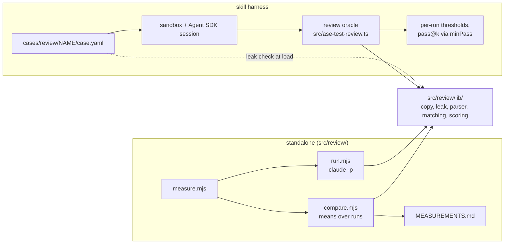
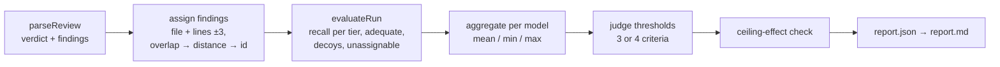
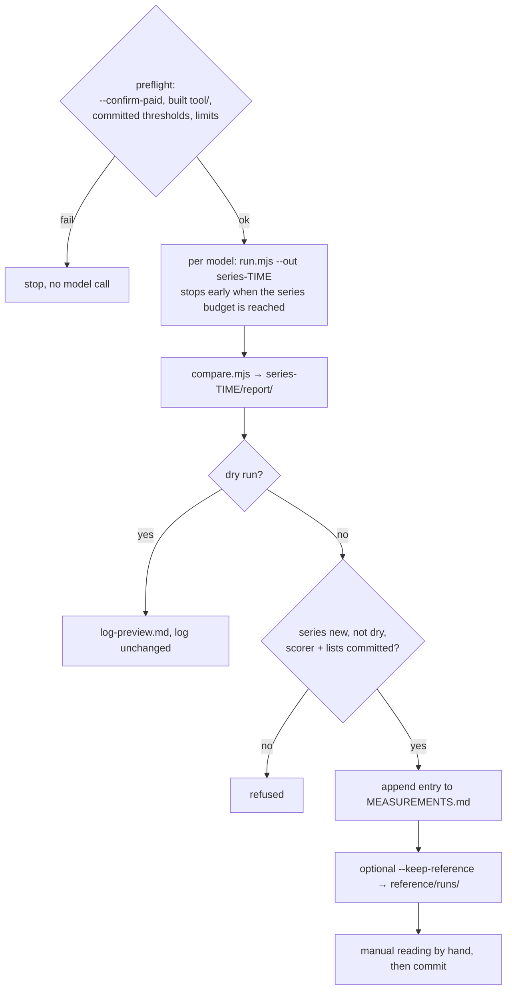

# Design of the `ase-repo-review` effectiveness test

The [README](README.md) tells the story of the test: why it exists, the cases,
and the results. This document is for the person who wants to change the test,
extend it, or argue with it. It states what the test promises, what it
deliberately leaves out, and the design decisions behind it, each with the
reason it was taken and the price it costs.

## What the test guarantees

If a change breaks one of these properties, the change is wrong or the property
needs an explicit, documented revision.

1. **Defined cases.** Each case consists of a base without intentionally seeded
   defects and exactly one change. Its expected-results list satisfies the rules
   of its version (see [List versions](#list-versions)).
2. **A valid expected-results list.** Every entry points to existing lines, and
   at least one of its locations lies in a line the change touches. A location
   outside the change is marked as such (version 5, defects only), lies in a file
   of the copy, and contains no changed line. `check.mjs` reports "valid" for
   every entry.
3. **No hint at the answers.** The working copy of a run contains neither the
   expected-results list nor any file name, comment, or commit message that hints
   at defects or decoys. The runner checks this before every model call.
4. **A fixed, bounded invocation.** A run calls `claude -p` without dialogue, with
   the plugin of this working copy and exactly `/ase:ase-repo-review -c HEAD -S LOW`,
   and keeps to its cost and time limit; when it exceeds one, it ends as `aborted`.
5. **A complete protocol.** Every result folder holds the requested and the
   reported model, the endpoint, the CLI version, the ASE version and commit,
   start time, duration, cost, status, and reason, plus the full transcript and
   the raw review.
6. **Scoring without a model.** Findings are assigned purely by file name and
   line overlap with a fixed tolerance. Applied twice to the same result folders,
   the comparison produces byte-identical JSON reports.
7. **A complete report.** Per model: recall per tier and overall (mean, minimum,
   maximum), decoy false-alarm rate, unassignable findings, the skill's verdict
   per run, unparseable runs, duration, and cost; with minimum severities also
   the recall with adequate severity.
8. **No silent zeros.** A review output that cannot be recognized is counted as
   `unparseable` and scored with zero hits, never quietly as "no findings".
9. **Pre-registered thresholds.** The thresholds are committed before the first
   paid run. The report names them, the version of their file, and the verdict
   "threshold met" or "threshold not met" per model. They are provisional
   criteria, not requirements derived from a concrete use.
10. **A ceiling-effect check.** If the strongest model finds every defect in
    every run, the report says "too easy"; otherwise "adequate", which only means
    that no ceiling effect was detected.
11. **Windows without Bash.** Runner, checks, and comparison run on Windows 11
    with Node.js alone, also from paths containing spaces.
12. **Other endpoints.** The model and an alternative endpoint
    (`ANTHROPIC_BASE_URL`, a token from a named variable) are parameters; the
    protocol records the endpoint but never the token.
13. **Contained.** The test lives in `cases/review/`, `src/review/`, and
    `docs/review/` of the skill harness, its standalone tools write into
    `results/review/`, and it changes nothing in the ASE repository (`plugin/`,
    `tool/`, `pages/`). The harness reuses its cases and library through a
    `case.yaml` per case.
14. **English throughout.** File names, identifiers, data formats, console
    output, reports, and documentation are English. The only exception is the
    deny list of the leak check, which must also catch German hints;
    `check-language.mjs` verifies this.

## What the test deliberately does not do

- It does not let a language model judge the findings.
- It does not measure what the ASE skill itself contributes; that would need a
  baseline with the same model and an ordinary review prompt.
- It does not change `ase-repo-review`, its sub-agent, or any other part of ASE.
- It measures one skill only. Its own runner is not part of the skill harness;
  the harness runs the same cases through its own sandbox and session.
- It ships the parameters for open-weight models, but no measurement with them.
- It runs neither in CI nor on a schedule; every group of paid runs needs a
  deliberate decision about its cost.
- The measurements do not use `--thorough`.
- A proof does not show that a review can find the defect, that a case is hard
  enough, or that the fixture has no weakness outside the list.

## Two entry points, one library

## Design decisions

### Plain Node.js modules, no dependencies

The scripts are ES modules (`.mjs`) that use only Node.js built-ins and need no
build step; the harness `package.json` (Node.js 22.22 or newer) only adds the
shortcuts `npm start review-selftest` and `npm start review-check-language`.
`prove.mjs` and the proof checks of `selftest.mjs` need Node.js 22.18 or newer.

*Why:* the test must run on Windows without Bash and without an install step.
*Price:* no TypeScript type check for the scripts; `selftest.mjs` compensates
with hand-computed expectations.

### A throw-away copy built from two directories

Each run copies `fixture/base/` into a fresh directory under the system's
temporary folder, commits it ("Initial version"), overlays `fixture/change/`,
removes the files listed in the optional `fixture/change.delete`, and commits
again with the message from the `case.yaml` of the case, with fixed dates and
`core.autocrlf=false`. The copy also receives a minimal ASE project
configuration.

*Why:* nested Git repositories would be fragile, and the line numbers of the
list must refer unambiguously to the state after the second commit. *Price:*
every change to the fixture requires re-running `check.mjs`.

### A leak check with a deny list

Before any model call, the runner verifies that the copy contains exactly the
expected files and that no file content, file name, or commit message contains a
term from a fixed deny list ("bug", "decoy", "TODO", "fixme", "hack", their
German counterparts, and terms of intent such as "intentionally", "on purpose",
"seeded", "planted") or an entry id like `B-01`. Multi-word terms match with
spaces, tabs, or hyphens between their words. A hit ends the run as `error` with
reason `leak`; the harness runs the same check when it loads a case.

*Why:* "the fixture gives nothing away" has to be a check, not a matter of care.
*Price:* the fixture may not use these words even in harmless code.

### Isolation by construction, verified at runtime

The CLI runs with `--setting-sources ""`, `--plugin-dir` pointing to this working
copy's plugin, and `--strict-mcp-config` with a generated `--mcp-config` naming
exactly the `ase` server. The model may read, search, and run `git`; editing,
writing, and web access are disallowed, and `--permission-mode dontAsk` prevents
questions. Inherited `CLAUDE*`, `ANTHROPIC_*`, and `npm_*` variables are removed.
`--bare` was rejected because it also switches off the ASE plugin's hooks.

The runner inspects the CLI's `init` event: another plugin (the CLI's built-in
plugins are only logged), another MCP server, or a missing `ase` server stops
the run as `error` with reason `isolation`. After the run, every tool call is
checked for access to `cases/review/`, `src/review/`, a `solution/` folder, or
the ASE repository outside `plugin/` and `tool/`; such a run ends as `error`
with reason `contamination` and is not evaluated.

*Why:* the expected-results list sits next to the plugin under test; only a
check makes a breach visible. *Price:* read access outside the copy can only be
limited, not prevented; it is detected afterwards. Paths obscured on purpose,
for instance through Git aliases, remain a residual risk.

### Hard cost and time limits, two steps for paid runs

Each run passes `--max-budget-usd` (default 5) to the CLI and is guarded by a
timer (default 20 minutes) that kills the whole process tree. Before every
further run the runner checks the series budget (default 30 USD): the spent
amount plus 1.1 × the per-run limit must fit. A run without a cost report counts
with its full limit; leftover ASE processes are stopped afterwards. Every run
without `--dry-run` requires `--confirm-paid`, a built `tool/`, limits no higher
than these defaults, and a `thresholds.json` that is valid and committed.

*Why:* paid runs were approved with fixed limits, and the pre-registration of the
thresholds must be secured technically. *Price:* the CLI stops only between
steps, so a run can end slightly above its limit; the protocol records the
actual amount.

### Dry runs cover everything but the model

`--dry-run` executes every step except the model call and replays a canned
`stream-json` transcript from the `testdata/` folder of the case (resp. of
`src/review/testdata/` for the special cases). `--simulate` produces the special
cases (cost abort, time abort, unparseable output, leak).

*Why:* most guarantees can be demonstrated without spending money. *Price:* a
dry run cannot prove that `claude -p` really loads the plugin.

### One result folder per run, never overwritten

Each run writes `results/review/<case>/<UTC time>-<model>-<n>[-dry]/` with
`run.json`, `transcript.jsonl`, `review.md`, and `stderr.txt`; `measure.mjs`
groups its runs in `series-<time>[-dry]/` with `report/` and, for a dry run,
`log-preview.md`. An existing folder is never overwritten, and `run.json` is
written last, so its presence marks a finished run. `results/` is not versioned;
runs worth keeping are copied into `reference/runs/` of the case.

*Why:* traceability, and a failed run must affect nothing but its own folder.
*Price:* transcripts can be large.

### A strict parser instead of interpretation

The parser reads the verdict line and the findings table in the fixed output
format of the skill. It tolerates small variations (checkbox character,
backticks, ranges, several ranges of one file such as `order.ts:29,51-52`,
escaped `|`) but does not interpret free text. Without a verdict, or without a
table or the line `**NO FINDINGS**`, the run is `unparseable`. A finding without
a recognizable location is unassignable.

*Why:* a format the scorer cannot read must show up as such instead of turning
into zero findings. *Price:* a format change in a later ASE version can make
runs unparseable; the report counts them visibly.

### Matching by location, with a tolerance

A finding matches an entry if it names the same file and one of its line ranges,
widened by three lines on each side, overlaps one of the entry's locations.
Among several candidates the largest overlap wins, then the smallest distance,
then the smallest id. Each entry counts at most once per run; further matches
are duplicates. `ACCEPTED` findings are neither hits nor false alarms. A match
on a decoy is a false alarm; everything else is unassignable. The tolerance is
fixed in `src/review/lib/matching.mjs`; the keys `matching_tolerance_lines`,
`runs_per_model`, and the budget keys in `thresholds.json` are informational
only.

*Why:* deterministic, no judging model, and the matching rule of the MERIT
effectiveness test. *Price:* coarse line ranges can hit a neighboring entry by
accident, so entries in the same file keep at least eight lines apart; and a
correct finding placed one hop away, at a call or a declaration, is missed.

### Metrics that cannot be gamed by failure

Recall is the share of defects hit, per tier and overall; the decoy false-alarm
rate is the share of decoys reported. An `unparseable` run enters recall with
zero hits but stays out of the false-alarm rate, since it would otherwise make
that rate look better. `aborted` and `error` runs enter no rate and are counted
separately. "Threshold met" requires all criteria at once: three, or four when
`thresholds.json` names `recall_adequate_min`.

*Why:* a model must not improve its score by producing unreadable output.
*Price:* the false-alarm rate may rest on fewer runs than recall, and it covers
only the predefined decoys (four or five per case), while unassignable findings
count nowhere. On reading, a remark on a decoy counts as a false alarm only if it
claims that the code behaves wrongly.

### A deterministic report

`report.json` has sorted keys, runs sorted by folder name, numbers rounded to
four decimals, and no timestamp. `report.md` is rendered from `report.json` only.
The threshold version is the last Git commit of `thresholds.json` plus a flag
for uncommitted changes.

*Why:* identical inputs must give byte-identical reports. *Price:* the report
carries no timestamp; the run protocols provide the time reference.

### Several cases, one scorer

A case is a directory `cases/review/<name>/` with `case.yaml`, `fixture/`,
`solution/expected.json`, `thresholds.json`, `testdata/`, and optionally
`reference/`, `fixture/change.delete`, `solution/proofs/`, and
`solution/fixes.json`. `src/review/lib/common.mjs` derives the case names from
these directories and the change commit message from their `case.yaml`, and
`resolveCase(name)` is the only place that knows the paths. All tools except
`selftest.mjs` and `check-language.mjs` take `--case` and default to
`correctness-cents`. Every run protocol records its case, and the comparison
evaluates only folders of the selected case.

*Why:* comparisons across cases need the same runner, scorer, and log. *Price:*
a result folder cannot be moved from one case to another.

### List versions

| Version | Case | Adds |
|---|---|---|
| 3 | `correctness-cents` | at least two defects per tier, at least one hidden defect spanning two files, at least three decoys |
| 4 | `security-refunds` | a minimum severity (`HIGH` or `MEDIUM`) per defect; at least one defect with two locations in the same file |
| 5 | `context-returns` | a class per defect, locations outside the change, and the structure of the case |

A matched defect counts as adequately reported when the highest severity among
its matched findings reaches its minimum; the threshold `recall_adequate_min`
applies only when the threshold file names it. *Why:* a refund hole reported as
a `LOW` style remark would be waved through. *Price:* the minimum severity is a
judgement, open to argument like the thresholds.

### Two tiers, and a list that says what makes a case hard

The base tier (`correctness-cents`, `security-refunds`) puts every defect in a
changed line with a familiar pattern. The hard tier (`context-returns`) records
in its list (version 5):

- a **class** per defect: `plain` for the obvious anchors, and for the others
  one of the context classes `false-assurance` (a comment or name promises a
  safety the code does not have), `omission` (the change is right in itself, an
  unchanged place no longer fits), `interplay` (two changes, each right, are
  wrong together), `sequence` (the defect shows only over a sequence of steps),
  and `domain` (business logic without a familiar pattern). Each context class
  must occur in a medium or hidden defect, and only an obvious defect is
  `plain`. A decoy may name the class it `resembles`.
- locations **outside the change** (`outside_change: true`): a file of the copy
  exactly as the copy lists it, with no changed line; only defects may have one,
  and every entry keeps one location in a changed line.
- the **structure** of the case: the least number of defects with a location
  outside the change (4), changed lines per defect (60), and changed files (10).
  `check.mjs` computes the figures with a fixed diff algorithm and fails for a
  list the fixture no longer meets.

The matching needs no change, and the hard tier asks for a lower overall recall.

*Why:* a case is only harder if a review must leave the diff, check a claim, or
think steps through; counting these properties keeps them true when the fixture
is edited. *Price:* a third list format; class and tier remain the author's
judgement; a review may report such a defect at a third place, which the
matching misses.

### Proofs for every entry of a list

A case may carry one test per entry in `solution/proofs/<id>.mjs` and one fix
per defect in `solution/fixes.json`, a list of text replacements. `prove.mjs`
builds the copy as a run would, derives the change, the change with the fix of
one defect, and the change with all fixes, translates their TypeScript, and runs
every test in a process of its own. A defect is proven if its test fails on the
change and passes with its own fix alone; a decoy if its test passes on the
change; with all fixes together every test must pass. A test that ends in
anything but a failed assertion (an exception, an unhandled rejection, a load
error, a timeout) counts as not proven, and an assertion it did not wait for
still counts. A fix whose text does not occur exactly once is not applied.

The translation uses `stripTypeScriptTypes` of `node:module`, which keeps the
line numbers, and appends `.mjs` to relative import specifiers. The fixture of
a case with proofs therefore imports types only with `import type`, uses no
enums or parameter properties, and writes its imports in one form (static,
double quotes, no suffix, `from` on the last line).

*Why:* the harder a defect, the easier it is to dispute; the fix of one defect
alone shows that this defect, and no other, makes the test fail. Separate
processes are needed because the example modules keep state in module variables,
and nothing under `solution/` can reach a working copy. *Price:*
`stripTypeScriptTypes` is experimental and may break with a later Node.js, which
would show as failed proofs, never as wrong figures. Only `context-returns` has
proofs so far.

### Cases are revised in place, with a placement rule for decoys

A case that needs better decoys or a cleaner fixture is changed in place; its
earlier state and the measurements taken on it stay in the Git history, and the
log names the commit. Every decoy is visibly correct in the code itself, not only
in its comment; belongs to the told change and has a caller; contains no call of
a seeded defect; lies outside the matching tolerance of every defect location
and every known weakness outside the list; and has no term of intent nearby.

*Why:* the pilot showed decoys that measured the fixture, not the review.
*Price:* figures before and after a revision are comparable per defect only.

### An append-only measurement log

`measure.mjs` (or `compare.mjs --journal docs/review/MEASUREMENTS.md` for
existing result folders) appends one section per measurement series, plus one
overview row per configuration.

The section holds the configuration (models, endpoint, ASE and CLI versions,
digests of the case and of the list at run and scoring time, threshold version,
commit of the scoring code), the automated figures, a defect-by-run and a
decoy-by-run matrix, every unassignable finding, and a template for the manual
reading. A series is identified by its result folder names plus the scorer
commit. The log refuses a series it already holds, dry runs, and uncommitted
scoring code or lists. Entries are never rewritten: a correction is a dated
note, a re-scoring is a new entry. Commit hashes in older entries refer to the
ASE repository, where the benchmark lived before.

*Why:* `report.md` follows the current scorer; comparisons over months need the
figures as they were computed, next to the manual reading. *Price:* the log
grows, and the overview of an old series may describe a since-fixed scorer; the
scorer commit in each entry says which.

## Known risks

- **Too easy, sample too small.** The strongest model found every base-tier
  defect in every pilot run on reading. On the hard tier both models found 22 of
  24 on reading, so it shows some headroom but does not yet separate them. Three
  runs per model show tendencies, not significant differences, and more runs fix
  neither matching errors nor the lack of variety.
- **The author of the hard case.** `context-returns` was written with Claude
  Fable; that model should not be measured on it, and its judgement of what is
  hard is built into the tiers and classes.
- **Scorer and reading disagree.** Location matching misses correct findings
  placed one hop away (in the hard-tier series, Sonnet described B-04 twice a
  few lines off) and credits unrelated findings with wide ranges. Automated
  figures must be read together with a manual check until the matching improves
  (alternative locations per defect, separate counting of very wide ranges).
- **The decoy rate measures locations, not claims.** In the pilot of
  `security-refunds` it reached 0.50 for both models without a single false
  alarm on reading. Security decoys provoke more remarks than style decoys, so
  the rates of the two base cases are not comparable; a severity-aware decoy
  rate remains open.
- **Unknown precision.** Unassignable findings are not classified, so the share
  of unfounded complaints outside the decoys is not measured.
- **A weakness outside the list of the hard case.** A `paid` event the provider
  repeats after the order has moved on is answered with an error, because the
  repeat check compares order and event status. A finding about it lands on the
  location of the defect about repeated refund events; the manual reading must
  tell the two apart.
- **Training data.** Once published, the fixture may end up in training data;
  a new, unpublished case would then be needed.
- **Skill format drift.** The skill output can change with new ASE versions; the
  protocol records the ASE version.
- **Cost figures** assume Anthropic prices and mean little for other endpoints.
- **Personal ASE configuration.** User-level ASE settings (persona, guidance
  level) still apply; according to the skill, the verdict and the findings table
  do not depend on them.
