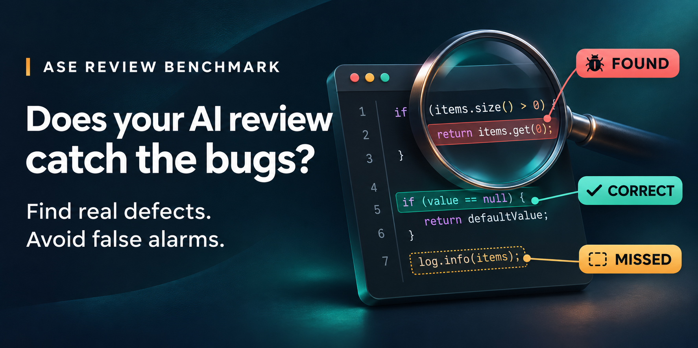
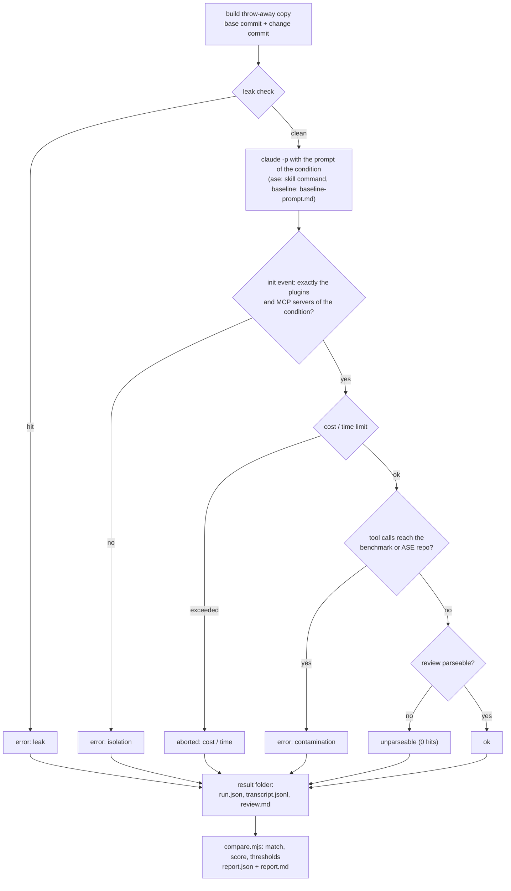

# Does the review find the bugs? An effectiveness test for `ase-repo-review`

[ASE](https://ase.tools) ships a skill called `ase-repo-review`: a packaged
prompt and workflow that the Claude Code CLI runs as a command. You point it at
a commit, and an AI model reads the change and writes a code review: a verdict
plus a table of findings, each with a severity and a file location. Such a
review can look convincing even when it misses defects. This benchmark asks a
plainer question: if we know exactly what is wrong with a change, how much of it
does the review catch, and how often does it complain about code that is fine?

**Status.** Three test cases. The pilot (2026-11-03, Claude Opus 5.5 and
Claude Sonnet 5.5, three runs each) measured earlier versions of the two
base-tier cases, found both too easy for Opus, and led to their revision
(see [What changed after the pilot](#what-changed-after-the-pilot)); the revised
cases are not yet measured. The hard case `context-returns` was measured on
2026-11-12 with the same models (see [Results](#results)). The numbers show
tendencies and the limits of the test itself, not a ranking.

## Purpose and scope

What is tested is not a model on its own but a whole review setup: the model,
the ASE skill and the helper agent it delegates the reading to, the Claude Code
CLI, the tools they may use, the fixed prompt, and the limits of a run. The
benchmark answers: *how does this ASE review setup behave with different models
under the same test conditions?*

A second measurement condition answers a second question: *how much of the
result comes from the ASE skill, rather than from the model and the tools it has
anyway?* The condition is part of every run protocol, report group, and log
entry:

| Condition | Prompt | Plugin and MCP server | Tools |
|---|---|---|---|
| `ase` (default) | `/ase:ase-repo-review -c HEAD -S LOW` | the ASE plugin of the surrounding working copy and the `ase` MCP server, both required | read, search, and git, plus `Skill` and `mcp__ase__*` |
| `baseline` | the text of `src/review/baseline-prompt.md` | neither; a plugin or server that still loads aborts the run | the same rights without `Skill` and `mcp__ase__*` |

Everything else is the same: the copy of the case, the two commits, the model,
the limits, the scorer. The baseline prompt prescribes the output format the
scorer reads (a verdict line and a findings table with severity, dimension, and
file and line), so the baseline is a review *with a format given to it*; the
comparison measures the skill's reading method, not its output format. No
baseline has been measured yet; [MEASUREMENTS.md](MEASUREMENTS.md) records the
condition of every series.

## How the test works

We wrote a small project, introduced a change to it, and deliberately seeded
defects into that change. Since we put them there, we know where they are and
can check whether the review reports them.

A reviewer that flags every second line would score perfectly on seeded defects
and still be useless. So the change also contains **decoys**: code that looks
suspicious but is correct, such as a commented fall-through in a `switch` or a
loose `== null` that deliberately covers both `null` and `undefined`.

The list of defects and decoys, the **expected-results list**, lives in
`cases/review/<name>/solution/expected.json` and never travels with the code
under review. The model sees a plain Git repository with two commits; no file
name, commit message, or comment hints at what we expect to be found.

### Case `correctness-cents`

A little TypeScript shop with a cart, discount codes, orders, refunds,
notifications, and an API layer. The change switches money amounts to integer
cents, adds discount kinds, order options with a currency, and some validation.
It carries seven seeded defects in three **tiers** and four decoys:

- **obvious**: visible in a single line, e.g. a loop that runs one position past
  the end of an array;
- **medium**: needs a little context, e.g. a missing `await` inside a `try`, so a
  failed save never reaches the `catch`;
- **hidden**: only shows when following the change across files, e.g. a function
  that now returns cents while its caller still formats euros.

### Case `security-refunds`

Starts from the same shop with those defects fixed and adds an admin refund
endpoint, a customer order lookup, a payment webhook, and HTML confirmation
mails. Its seven defects are the kind an attacker looks for: a refund amount
taken from the request, a role check that lets callers without a role through,
an order lookup that never asks who is asking, a webhook that verifies the
signature only when one is sent, a discount code pasted into HTML unescaped, a
refund of the amount before the discount, and a failed payment that keeps the
stock reserved. Its four decoys look like security smells but are fine. Each
defect records a **minimum severity** (`HIGH` for money, other people's data,
and payment events; `MEDIUM` for mail injection and blocked stock): a security
hole reported as `LOW` is half missed. The change also deletes a file
(`fixture/change.delete`).

### Case `context-returns`, the hard tier

The first two cases form the **base tier**: every defect sits in a changed line
and follows a familiar pattern. The **hard tier** is meant to leave headroom at
the top: its defects only show to a review that reads beyond the changed lines,
checks what comments and names promise, and thinks a sequence of steps through.

It has its own, larger copy of the shop (twelve modules, among them an order
store and a revenue report). The change adds store credit, refunds that stay
pending until the payment provider reports them, and returns with a 14-day
window: eleven files, 498 changed lines, eight defects, about 62 changed lines
per defect where the base tier has 24 and 34. Two defects are **obvious**
anchors; the other six each belong to a context **class** (sequence, domain,
omission twice, false assurance, interplay), and four of them name a location
**outside the change**, in an unchanged module. Its five decoys resemble these
classes and are correct in the code itself. The classes and the structure rules
of its list (version 5) are defined in
[DESIGN.md](DESIGN.md#two-tiers-and-a-list-that-says-what-makes-a-case-hard).

The case was written with Claude Fable (5.1 and 5.2), so these models are not
candidates for it.

### Proofs instead of claims

A subtle defect is easier to dispute than an obvious one. Every entry of the
hard case therefore comes with a test, and every defect with a small fix of its
own, under `cases/review/context-returns/solution/`:

```
node src/review/prove.mjs --case context-returns
```

A defect counts as **proven** if its test fails on the change and passes with
its own fix alone; a decoy if its test passes on the change; with all fixes
together every test must pass. The command calls no model, costs nothing, and
needs Node.js 22.18 or newer. A proof shows that the code behaves wrongly, not
that a review can find the defect. Mechanics:
[DESIGN.md](DESIGN.md#proofs-for-every-entry-of-a-list).

### What changed after the pilot

The manual reading of the pilot showed that the decoy match rate of both
base-tier cases measured flaws of the fixtures more than false alarms of the
review: a decoy weaker than its comment, a `catch` that could never run, dead
code, a decoy wrapped around the call of a defect, and two real weaknesses
outside the list. The revision fixed exactly this and left the defects as they
were (same ids, tiers, titles, minimum severities, and thresholds; only
locations moved). The pilot cases were then called `shop-core` and `security`.
Details are in the pilot summary of [MEASUREMENTS.md](MEASUREMENTS.md) and in
[DESIGN.md](DESIGN.md#cases-are-revised-in-place-with-a-placement-rule-for-decoys);
the pilot fixtures, lists, and runs remain in the Git history of the ASE
repository at commit `13014184`.

## Results

Every measurement series goes into the log [MEASUREMENTS.md](MEASUREMENTS.md)
with the values computed at the time, a defect-by-run matrix, the findings the
scorer could not assign, and the manual reading.

| Series | Case | Model | Recall overall (automated) | Decoy match rate | Thresholds | Manual reading |
|---|---|---|---|---|---|---|
| 2026-11-03 (pilot) | earlier base-tier cases | Opus, Sonnet | see log | see log | – | Opus found all 7 defects in every run of both cases |
| 2026-11-12, re-scored 2026-11-13 | `context-returns` | Opus | 0.92 | 0.00 | met | 22 of 24 defects, 0 of 15 decoy false alarms |
| 2026-11-12, re-scored 2026-11-13 | `context-returns` | Sonnet | 0.83 | 0.00 | met | 22 of 24 defects, 0 of 15 decoy false alarms |

The first scoring of the 2026-11-12 series gave 0.79 for both models; the
re-scoring added a second location for one defect (B-07). Opus missed one
defect in two of its runs, so the ceiling-effect check says "adequate".

### Reading the figures

The scorer assigns each finding to an expected entry **only by file name and
line overlap** (rule: [DESIGN.md](DESIGN.md#matching-by-location-with-a-tolerance));
a correct finding placed at a different line, say at the caller, does not count.
All values are means over the runs of a configuration.

- **Location-matched recall**: the share of the defects with a finding at a
  matching location, overall and per tier.
- **Decoy match rate**: the share of the decoys with a finding at a matching
  location, whatever that finding says. The generated reports call the same
  number "decoy false-alarm rate".
- **Unassignable findings**: findings per run that match neither a defect nor a
  decoy: real extra defects, fair remarks, or unfounded complaints.
- **Recall with adequate severity** (lists with minimum severities): defects
  matched *and* reported with at least their minimum severity.
- **Automated thresholds**: provisional pass marks in `thresholds.json`,
  committed before the first paid run of a case. Base tier: overall recall
  ≥ 0.6, obvious ≥ 0.8, decoy match rate ≤ 0.25; `security-refunds` adds
  adequate-severity recall ≥ 0.5. Hard tier: overall ≥ 0.5, obvious ≥ 0.8,
  decoy match rate ≤ 0.25, adequate ≥ 0.4. "Met" judges the automated figures
  only, never the reading.
- **Ceiling-effect check**: "too easy" if the strongest model finds every
  defect in every run; "adequate" only means no ceiling effect was detected.
- **Conditions**: thresholds and ceiling-effect check are set for the `ase`
  condition; a `baseline` group shows every figure, but
  `threshold not applicable` in place of a verdict and no ceiling-effect
  statement.

The decoy match rate covers only a few predefined spots: a review that finds all
defects, leaves the decoys alone, and adds twenty unfounded complaints elsewhere
still scores 0. That is why the unassignable findings stand next to it, and why
every series gets a manual reading, in which a finding on a decoy counts as a
false alarm only if it claims the code behaves wrongly. The known limits of the
test are listed under [Known risks](DESIGN.md#known-risks).

## Quick start

You need Node.js 22.22 or newer (as the harness) and Git. These commands cost
nothing and show the whole pipeline with a canned review; every command takes
`--case <name>` and defaults to `correctness-cents`:

```
node src/review/check.mjs --case security-refunds
node src/review/run.mjs --dry-run --case security-refunds
node src/review/compare.mjs --case security-refunds
```

`prove.mjs` needs `--case context-returns`, the only case with proofs.

### A real measurement

A real measurement costs money. It needs the Claude Code CLI (`claude`) with a
login and a commit of the case and the scoring code in this repository, so the
log can name what produced the figures. Runs in the `ase` condition also need
the built `tool/` of the surrounding ASE working copy
(`cd ../tool && npm start build`); runs in the `baseline` condition need no
built tool, but a committed `src/review/baseline-prompt.md`. One command runs
the models, compares, and appends the log entry:

```
node src/review/measure.mjs --case security-refunds --confirm-paid
node src/review/measure.mjs --case security-refunds --conditions ase,baseline --confirm-paid
```

By default it runs Opus and Sonnet three times each (`--models`, `--runs`). All
runs go into one folder `results/review/<case>/series-<time>/`, and only these
runs are compared and logged. Fill in the two manual-reading columns at the end
of the new entry in [MEASUREMENTS.md](MEASUREMENTS.md) by hand, then commit the
log. `--keep-reference` also copies the runs into `reference/runs/` of the case
for later re-scoring without cost. `--dry-run` instead writes a preview
(`log-preview.md`) into the series folder and leaves the log alone. Unless
`--title` names it, the entry is headed by the start date, the case, the
conditions, and the models, for example
`2026-11-20: context-returns, ase+baseline, opus, sonnet`.

If the series budget runs out before all planned runs are done, the series is
neither compared nor logged: `measure.mjs` names the missing runs per condition
and model, ends with exit code 3, and leaves the completed runs in the series
folder. A log entry cannot be taken back, and a series with groups of unequal
size, or with one condition missing, is not a comparison; `--conditions`
refuses a condition named twice for the same reason.

### The run pipeline



In the `ase` condition the CLI runs with only the ASE plugin of this working
copy and only the `ase` MCP server; in the `baseline` condition with neither, and
the isolation check fails a run that loads either. The model may read, search,
and run `git`, but not edit, write, or go to the web. After a run in the `ase`
condition the runner kills processes the skill left behind; a baseline run
starts none and leaves the ASE processes of the machine alone. Each run has a cost limit (5 USD) and a time limit (20 minutes); a
series has a total budget (30 USD), and a further run starts only while the
spent amount plus 1.1 × the per-run limit fits. `--budget`, `--timeout-min`, and
`--total-budget` can only lower these limits for paid runs. Other statuses:
`error` also for `start`, `no-result`, and `internal`. Details and reasons:
[DESIGN.md](DESIGN.md#design-decisions).

### Running through the skill harness

Every case also carries a `case.yaml`, so the skill harness runs it as
`review/<name>` with its own sandbox and session:

```
npm start test -- --cases='review/*'
```

There, each run is judged on its own against `thresholds.json` (pass@k via
`minPass`); the mean figures, the committed-thresholds guard, and the log stay
with `measure.mjs`. The contract of the `review` oracle is in the harness
[TESTS.md](../../TESTS.md).

### Options

`node src/review/<tool>.mjs --help` lists the options of a tool. Beyond the
above:

- `run.mjs`: `--condition ase|baseline` (default `ase`), `--model`, `--runs`,
  `--prior-spent`, `--keep` (keep the copy),
  `--out`, `--replay <file>`, `--simulate unparseable|abort-cost|abort-time|leak`;
- `measure.mjs`: `--conditions <list>` (default `ase`), `--models`, `--runs`,
  `--title`, `--keep-reference`;
- `compare.mjs`: `--out <dir>` (default `results/review/<case>/report/`),
  `--title`, `--journal <file>`, and result folders as arguments; without them
  it scans one level below `results/review/<case>/`, so runs inside a
  `series-*` folder need that folder as argument;
- `check.mjs`: `--expected <file>`; `check-language.mjs`: `--root <dir>`.

Other endpoints (open-weight models):

```
export BENCH_TOKEN="<provider token>"
node src/review/run.mjs --model <model-id> --base-url https://provider.example/v1 --auth-token-env BENCH_TOKEN --confirm-paid
```

`--base-url` sets `ANTHROPIC_BASE_URL`, `--auth-token-env` sets
`ANTHROPIC_AUTH_TOKEN` from the named variable; the protocol records the
endpoint, never the token. Cost figures assume Anthropic prices.

### Testing the benchmark

These commands check the benchmark itself, not a model, and cost nothing:

```
node src/review/selftest.mjs                 # also: npm start review-selftest
node src/review/check-language.mjs           # also: npm start review-check-language
node src/review/prove.mjs --case context-returns
node src/review/run.mjs --dry-run --simulate unparseable
node src/review/run.mjs --dry-run --simulate abort-cost
node src/review/run.mjs --dry-run --simulate abort-time
node src/review/run.mjs --dry-run --simulate leak
node src/review/run.mjs --dry-run --replay src/review/testdata/contamination.jsonl
```

The `normal.jsonl` of a case serves both conditions: a dry run fits the `init`
event of the transcript to its condition, for `baseline` without the ASE plugin
and server, so both conditions replay the same review and a dry run shows the
condition at work, not a different result. A transcript given with `--replay`
is replayed as it is. Dry runs appear in the report as a separate group
"(dry run)" and are never logged.

### Layout

| Path | Content |
|---|---|
| `cases/review/<name>/` | `case.yaml` (harness case, also the source of the change commit message), `fixture/base/`, `fixture/change/`, optional `fixture/change.delete`, `solution/expected.json` (never part of a working copy), `thresholds.json`, `testdata/normal.jsonl` |
| `cases/review/context-returns/` | additionally `solution/proofs/` (one test per entry), `solution/fixes.json` (one fix per defect), and `reference/runs/` (the six runs of 2026-11-12) |
| `src/review/*.mjs` | the tools: `check`, `prove`, `run`, `compare`, `measure`, `selftest`, `check-language` |
| `src/review/baseline-prompt.md` | the whole file is the prompt of the `baseline` condition, whatever its line endings; it must be committed before a paid baseline run |
| `src/review/lib/` | parser, matching, scoring, list rules, leak check, copy, runner, proofs, report, log; `src/review/lib/common.mjs` holds all paths; the harness uses it through `src/ase-test-review.ts` |
| `src/review/testdata/` | canned transcripts of the special cases, and six real pilot runs as test data |
| `docs/review/` | this README, [DESIGN.md](DESIGN.md) (guarantees, decisions, risks; read it before changing fixture, matching, or isolation), [MEASUREMENTS.md](MEASUREMENTS.md) (log, never rewritten), `assets/` |
| `results/review/<case>/` | result folders, series, and reports (not versioned) |

## Origin

Approach and matching rule follow the effectiveness test of MERIT, a separate
project with its own test of an AI reviewer (`tests/effectiveness/`); the code
here is written from scratch.
